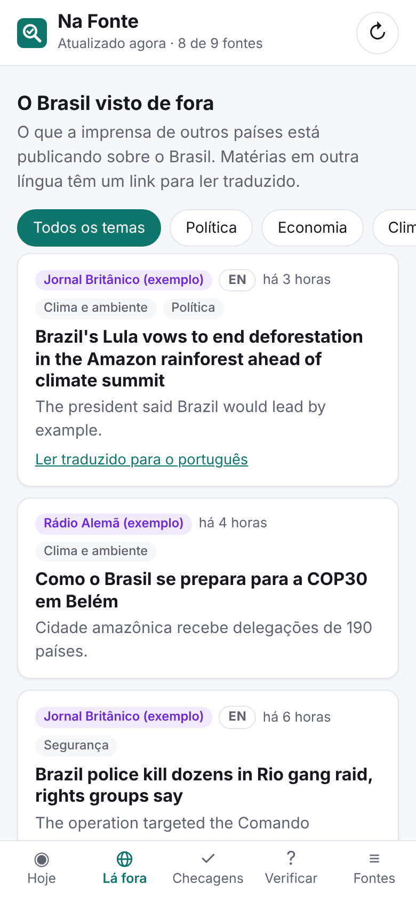
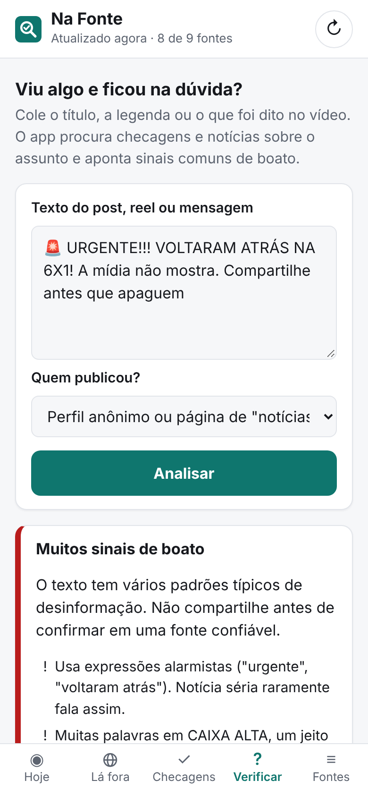

# Na Fonte

[](https://github.com/jpmelo031/na-fonte/actions/workflows/testes.yml)
[](LICENSE)

Notícias de fontes confiáveis, checagens, o Brasil visto de fora e um filtro rápido contra boatos,
num lugar só.

A ideia é trocar o feed infinito de reels por uma leitura curta, vinda direto de quem apura:
agências de checagem, órgãos oficiais e veículos de imprensa com linhas editoriais diferentes,
do Brasil e de fora.

<p>
  
  
  
</p>

<sub>Telas com dados de exemplo: "Jornal A", "Agência Oficial Exemplo" e as outras fontes das imagens são fictícias.</sub>

## O que o app faz

| Aba | Para quê |
| --- | --- |
| **Hoje** | Mostra os **assuntos noticiados por várias fontes ao mesmo tempo** (quanto mais redações independentes, mais difícil ser boato), avisa quando uma fonte oficial também noticiou e quando existe checagem sobre o assunto. Embaixo, as últimas notícias, com filtro por fontes oficiais e veículos. |
| **Lá fora** | O Brasil visto pela imprensa de outros países: DW e RFI (que escrevem em português), The Guardian, New York Times, BBC, El País, France 24 e Al Jazeera. Dos feeds gerais só entram as matérias que falam do Brasil, e as que estão em outra língua têm um link "Ler traduzido". |
| **Checagens** | O que Aos Fatos, Lupa, Fato ou Fake, Estadão Verifica, Boatos.org e E-farsas confirmaram ou desmentiram, com o veredito (Falso / Enganoso / Verdadeiro) quando ele aparece no título. |
| **Verificar** | Você cola o texto de um reel, post ou mensagem de WhatsApp. O app procura checagens e notícias sobre o assunto, aponta sinais típicos de boato (CAIXA ALTA, "URGENTE!!!", "compartilhe antes que apaguem", falta de fonte) e gera buscas prontas nas agências de checagem. |
| **Fontes** | Lista de todas as fontes, com a data da última notícia de cada uma, e um filtro rápido para reels. |

Tocar numa notícia abre o **modo leitura**: o texto da matéria aparece por cima do app, sem
anúncios, menus, "leia também", chamadas de newsletter nem links para outras notícias. O botão
"Abrir no site" continua lá para quando você quiser ir ao site (Ctrl+clique também abre direto).

Nas abas Hoje e Lá fora dá para **filtrar por tema**: Política, Economia, Clima e ambiente,
Ciência e tecnologia, Saúde, Educação, Segurança, Mundo, Esportes e Cultura.

O app **não decide o que é verdade**. Ele junta as fontes, mostra quem mais está falando do mesmo
assunto e aponta checagens. As regras são simples e estão escritas para serem lidas e ajustadas
(veja [Como o app decide as coisas](#como-o-app-decide-as-coisas)).

## Como rodar

Precisa do [Node.js](https://nodejs.org) 22 ou mais novo.

```bash
git clone https://github.com/jpmelo031/na-fonte.git
cd na-fonte
npm install
npm start
```

Depois abra <http://localhost:3000>. As fontes são atualizadas sozinhas a cada 15 minutos
(mude com `INTERVALO_MINUTOS=30 npm start`; a porta muda com `PORT=8080 npm start`).

**No celular, pelo computador:** com os dois no mesmo Wi-Fi, abra `http://IP-DO-COMPUTADOR:3000`
no navegador do celular. No menu do navegador, use "Adicionar à tela inicial" para ele virar um
ícone como um app.

### Direto no celular Android (Termux)

Dá para rodar o app inteiro no próprio celular com o [Termux](https://termux.dev):

```bash
pkg update && pkg upgrade        # responda "y" / Enter
pkg install nodejs git
git clone https://github.com/jpmelo031/na-fonte.git
cd na-fonte
npm install
termux-wake-lock                 # impede o Android de fechar o Termux em segundo plano
npm start
```

Com o `npm start` rodando, abra o Chrome do celular em <http://localhost:3000> e use
"Adicionar à tela inicial". Para parar: `CTRL` + `C` no Termux. Para atualizar: `git pull` e
`npm install`.

**No celular do [The Far Fire](https://github.com/jpmelo031/the-far-fire)**, onde o app roda como a
fogueira `na-fonte`, quem atualiza é o `scripts/atualizar.sh`, a partir de um clone em `~/src/na-fonte`:
ele faz `git pull`, copia o app pra `~/na-fonte/app` e reacende a fogueira.

```bash
bash ~/src/na-fonte/scripts/atualizar.sh
```

## Fontes

A lista completa, com os endereços dos feeds, está em [`src/fontes.js`](src/fontes.js).

- **Checagem:** Aos Fatos, Agência Lupa, G1 Fato ou Fake, Estadão Verifica, Boatos.org, E-farsas.
- **Fontes oficiais:** Agência Senado, Agência Câmara, Agência Brasil.
- **Veículos:** G1, Folha de S.Paulo, Estadão, UOL, BBC News Brasil, Poder360.
- **Imprensa internacional:** DW Brasil, RFI Brasil, The Guardian, The New York Times, BBC News,
  El País, France 24, Al Jazeera.

Projeto Comprova, Planalto, Agência Gov, STF e TSE ficaram de fora porque não têm um feed RSS útil
(detalhes no topo de [`src/fontes.js`](src/fontes.js)). A aba Verificar continua buscando no site
do Comprova.

### Conferir se as fontes estão funcionando

Endereços de RSS mudam de vez em quando. Para testar:

```bash
npm run checar-fontes                    # todas as fontes
npm run checar-fontes -- internacional   # só uma categoria
npm run checar-fontes -- senado          # tudo o que uma fonte trouxe
npm run checar-fontes -- https://site.com/feed/   # um endereço novo, antes de colocar no app
```

Ele mostra `OK` ou `ERRO` para cada fonte, com a data da notícia mais nova, e avisa quando um feed
parece parado. Uma fonte com problema nunca derruba o app: ela só aparece em vermelho (ou laranja,
se estiver parada) na aba Fontes, e o app continua mostrando as notícias da última vez que ela
funcionou.

## Como o app decide as coisas

- **Assuntos em vários veículos:** compara as palavras importantes dos títulos das últimas 48 horas
  (palavras raras pesam mais que "governo" ou "Brasil") e junta manchetes parecidas de fontes
  **diferentes**. Repetir a mesma notícia na mesma fonte não conta como confirmação.
- **Checagens relacionadas:** procura checagens que tenham as palavras importantes do assunto ou do
  texto colado, entendendo variações como "voltou" e "voltaram".
- **Sinais de boato:** uma lista de padrões de forma (palavras alarmistas, caixa alta, excesso de
  exclamação, emojis de alerta, pedido para compartilhar, "a mídia esconde") e de sinais de
  confiança (cita lei, data, instituição ou quem disse). Isso mede o jeito de escrever, não a verdade.
- **"Título sensacionalista?":** aparece em manchetes que têm pelo menos dois sinais de forma.
- **Temas:** cada notícia ganha até dois temas, somando pistas: a seção no endereço da matéria
  (`g1.globo.com/politica/...`), as categorias que o próprio feed informa e palavras-chave no título
  e no resumo (em português, inglês e espanhol). Senado e Câmara contam sempre como Política.
- **Lá fora:** das fontes marcadas com `sobreBrasil` só entram matérias que citam o Brasil
  (Brasil/Brazil/Brésil, Lula, Bolsonaro, Amazônia, Rio, São Paulo, Petrobras...).
- **Modo leitura:** baixa a página da matéria na hora em que você abre e passa pelo
  [Readability](https://github.com/mozilla/readability) (o mesmo do modo leitura do Firefox), que
  separa o texto de menus, anúncios e barras laterais. Depois um filtro próprio tira o que os sites
  colocam *dentro* da matéria: parágrafos que são só link para outra notícia, "LEIA MAIS", "Siga o
  canal", chamadas de assinatura e newsletter, créditos de foto, tags e posts de rede social
  embutidos. Ele mostra o que o site entrega publicamente: quando a matéria é para assinantes e
  vem cortada, o app avisa e oferece abrir no site. Só abre links que vieram dos feeds.

## Contribuir

Sugestões, correções de fontes e melhorias são bem-vindas, por issue ou pull request.

- **Fonte nova ou endereço quebrado:** teste com `npm run checar-fontes -- <endereço>` e edite
  [`src/fontes.js`](src/fontes.js).
- **Tema errado:** as palavras de cada tema ficam em [`src/temas.js`](src/temas.js).
- **Sinais de boato e agrupamento:** [`src/analise.js`](src/analise.js).
- **Lixo que escapou no modo leitura:** os padrões ficam em [`src/leitura.js`](src/leitura.js).
- Antes de enviar, rode `npm test`. Os testes usam feeds de exemplo locais e não acessam a internet.

```
server.js            inicia o servidor
src/fontes.js        lista de fontes
src/feeds.js         baixa os feeds, com tolerância a falhas
src/xml.js           lê RSS e Atom (inclusive feeds em ISO-8859-1)
src/analise.js       agrupamento, checagens relacionadas e sinais de boato
src/temas.js         temas do filtro e o filtro "fala do Brasil"
src/leitura.js       modo leitura: extrai só o texto da matéria
src/app.js           servidor HTTP e API (/api/noticias, /api/verificar)
public/              a interface (HTML, CSS e JS puros)
scripts/             checar-fontes e atualizar (no celular do The Far Fire)
test/                testes automáticos
```

### Ideias para o futuro

- Versão online, para abrir de qualquer lugar sem rodar nada.
- Resumo diário de 5 minutos por e-mail ou Telegram com os assuntos em várias fontes.
- Avisar quando sair uma checagem sobre algo que você colou na aba Verificar.
- Fontes regionais e mais veículos de linhas editoriais diferentes.

## Aviso

O Na Fonte não tem relação com nenhum dos veículos, agências ou órgãos listados. Ele lê os feeds
RSS que eles publicam e, no modo leitura, a página da matéria que você abriu, na hora, só para você,
sem guardar nem republicar nada. O link para a matéria original está sempre visível. Todo o
conteúdo das notícias pertence aos seus autores.

## Licença

Copyright (C) 2026 jpmelo031

Este programa é software livre: você pode redistribuí-lo e/ou modificá-lo sob os termos da
[GNU General Public License](LICENSE), versão 3 ou (a seu critério) qualquer versão posterior.
Ele é distribuído na esperança de ser útil, mas SEM NENHUMA GARANTIA.
